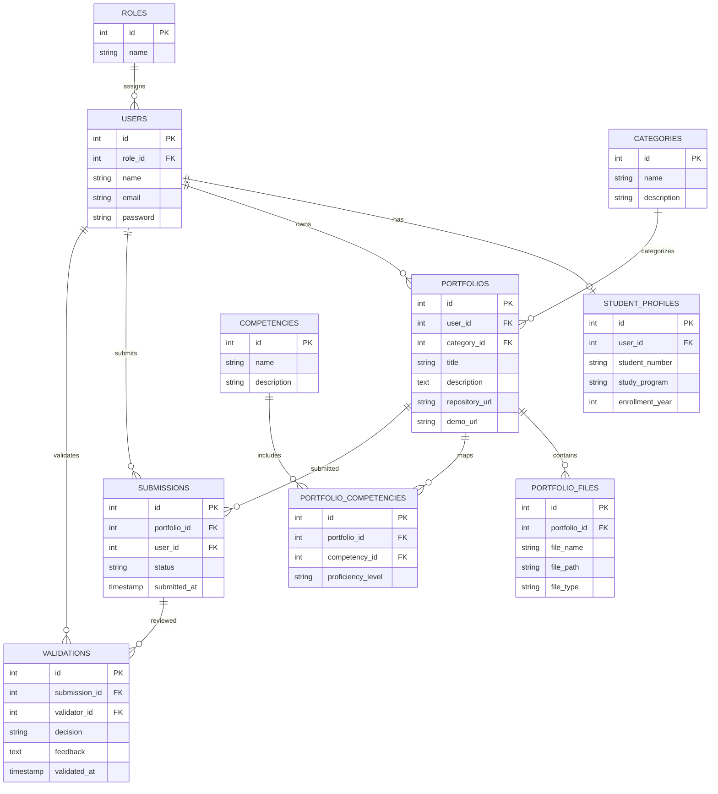

# SkillProf — Student Portfolio and Competency Validation System

**Show Your Skills. Prove Your Value.**

SkillProf is a web-based application designed to help university students document, manage, and validate their portfolios and competencies.

The platform allows students to submit their projects, certificates, organizational experiences, internships, achievements, and skills along with supporting evidence. Submitted portfolios can be reviewed and validated by authorized lecturers or validators.

SkillProf aims to provide a centralized platform for documenting student achievements and establishing credible records of their competencies through a structured validation process.

## 1. Project Objectives

The main objectives of SkillProf are:

- Provide a centralized platform for managing student portfolios.
- Help students document their academic and non-academic achievements.
- Provide a structured process for validating student competencies.
- Allow authorized validators to review portfolio submissions and supporting evidence.
- Help academic administrators monitor student portfolio and competency records.

## 2. User Roles and Permissions

SkillProf has three main user roles:

| Role | Description | Permissions |
|---|---|---|
| Admin | Manages the application and its supporting data. | Manage user accounts, portfolio categories, competency categories, and monitor system activities. |
| Validator | Reviews and validates student portfolio submissions. | View submissions, examine supporting evidence, approve, reject, or request revisions. |
| Student | Manages personal portfolios and competencies. | Manage profile, create portfolios, upload supporting evidence, submit validation requests, and view validation results. |

## 3. Main Features

### Authentication and Authorization
- User registration and login.
- JWT-based authentication.
- Role-based access control.

### Student Profile Management
- Manage student personal information.
- View student profile details.

### Portfolio Management
- Create, view, update, and delete portfolios.
- Document projects, certificates, experiences, and achievements.
- Upload supporting documents and images.
- Add project repository and demonstration links.

### Competency Management
- Manage student competencies.
- Organize competencies by category.
- Associate competencies with portfolio evidence.

### Portfolio Validation
- Submit portfolios for validation.
- Review portfolio information and supporting evidence.
- Approve, reject, or request revisions.
- Provide validation notes and feedback.

### Validation History and Reports
- View previous validation records.
- Track portfolio validation statuses.
- Display validated student competencies.

## 4. Portfolio and Competency Categories

Students can document the following types of achievements:

| Category | Description |
|---|---|
| Projects | Software projects, applications, research projects, and other works. |
| Certificates | Training, workshops, seminars, and professional certifications. |
| Experiences | Organizational activities, volunteering, internships, and committee experiences. |
| Achievements | Competitions, awards, and academic or non-academic accomplishments. |
| Competencies | Technical and non-technical skills supported by relevant evidence. |

Each portfolio entry can contain descriptions and supporting evidence such as documents, images, or external links.

## 5. Validation Workflow

The validation process follows these steps:

1. Students register and log in to the application.
2. Students complete their profiles.
3. Students add portfolio entries and competencies.
4. Students upload supporting evidence.
5. Students submit their portfolios for validation.
6. Validators review the submitted information and evidence.
7. Validators provide a decision:
   - **Approved:** The submission is accepted.
   - **Revision:** The student must improve or complete the submission.
   - **Rejected:** The submission is not accepted.
8. Students can view validation results and feedback.

### Submission Status

| Status | Description |
|---|---|
| `draft` | Portfolio data is still being prepared. |
| `submitted` | Portfolio has been submitted for validation. |
| `revision` | Portfolio requires corrections. |
| `approved` | Portfolio has been successfully validated. |
| `rejected` | Portfolio has been rejected. |

## 6. Database Design

The initial database design consists of the following tables:

| Table | Description |
|---|---|
| `roles` | Stores application user roles. |
| `users` | Stores user account information. |
| `student_profiles` | Stores student profile information. |
| `categories` | Stores portfolio categories. |
| `portfolios` | Stores student portfolio records. |
| `competencies` | Stores competency information. |
| `portfolio_competencies` | Connects portfolios with competencies. |
| `submissions` | Stores portfolio validation submissions. |
| `validations` | Stores validation decisions and feedback. |
| `portfolio_files` | Stores supporting portfolio file information. |

### Entity Relationship Diagram (ERD)



*Note: This is the initial database design. Table structures, relationships, and attributes may be adjusted during implementation based on the finalized database schema.*

## 7. Project Architecture

SkillProf uses Clean Architecture principles to separate application responsibilities and maintainability.

### Project Structure

```text
skillprof/
│
├── app/
│   ├── model/
│   ├── repository/
│   └── service/
│
├── config/
│   ├── app.go
│   ├── env.go
│   └── logger.go
│
├── database/
│   └── postgres.go
│
├── helper/
│   ├── password.go
│   └── response.go
│
├── middleware/
│   ├── jwt.go
│   └── request_logger.go
│
├── route/
│
├── migrations/
│
├── logs/
│
├── .env.example
├── .gitignore
├── go.mod
├── go.sum
└── main.go
```

### Architecture Responsibilities

| Layer | Responsibility |
|---|---|
| Model | Defines application entities and request/response structures. |
| Repository | Handles database operations and data access. |
| Service | Handles application logic and business processes. |
| Config | Manages application configuration and initialization. |
| Database | Manages PostgreSQL connections. |
| Middleware | Handles authentication, authorization, and request logging. |
| Helper | Provides reusable utility functions. |
| Route | Registers API endpoints and connects them to services. |
| Main | Initializes and runs the application. |

## 8. Technologies Used

| Technology | Purpose |
|---|---|
| Go | Backend programming language. |
| Fiber v2 | Web framework for RESTful API development. |
| PostgreSQL | Relational database management system. |
| pgx/v5 | PostgreSQL driver and connection pool. |
| JWT | User authentication. |
| bcrypt | Password hashing. |
| godotenv | Environment variable configuration. |
| Lumberjack | Log rotation and file management. |
| Git | Version control. |
| GitHub | Source code hosting and team collaboration. |

## 9. Team Members and Responsibilities

| Member | Role | Responsibilities |
|---|---|---|
| Saniyatul Warda | Git Master & Backend Setup Developer | Project setup, configuration, database connection, logging, authentication, authorization, user profile, and system integration. |
| Edgina Cybil | Database Developer | Database design, ERD, migrations, models, repositories, category management, and database testing. |
| Aldha Zahro M | Backend Feature Developer | Portfolio management, file uploads, validation submissions, validation processes, validation history, and competency reports. |

## 10. Installation and Setup

### Prerequisites

Make sure the following tools are installed:

- Go
- PostgreSQL
- Git
- Visual Studio Code (recommended)

### 1. Clone the Repository

```bash
git clone https://github.com/YOUR-USERNAME/skillprof.git
cd skillprof
```

### 2. Install Dependencies

```bash
go mod tidy
```

### 3. Configure Environment Variables

Copy `.env.example` to `.env` and update the configuration according to your local environment.

Example:

```env
APP_NAME=SkillProf
APP_PORT=3000
APP_ENV=development

DB_HOST=localhost
DB_PORT=5432
DB_USER=postgres
DB_PASSWORD=your_password
DB_NAME=skillprof
DB_SSLMODE=disable

JWT_SECRET=your_secret_key
```

**Important:** Never commit your actual `.env` file or expose database credentials and JWT secrets.

### 4. Create the Database

Create a PostgreSQL database named:

```sql
CREATE DATABASE skillprof;
```

### 5. Run Database Migrations

Execute the migration SQL files in the appropriate order after the database schema and migration scripts are prepared.

### 6. Run the Application

```bash
go run main.go
```

The application will run on the configured port.

## 11. GitHub Collaboration Workflow

The project uses a feature-branch workflow to support collaborative development.

1. The Git Master creates and manages the main repository.
2. Each team member works on a separate feature branch.
3. Changes are committed in small, incremental commits.
4. Team members push their branches to GitHub.
5. Team members create Pull Requests targeting `main`.
6. The Git Master reviews and merges approved changes.
7. Team members synchronize their local repositories with the updated `main` branch.

### Branch Naming Convention

| Branch | Purpose |
|---|---|
| `main` | Main application branch. |
| `feature/project-setup` | Initial project configuration. |
| `feature/authentication` | Authentication and authorization. |
| `feature/database` | Database schema and repository. |
| `feature/category-management` | Portfolio and competency categories. |
| `feature/portfolio-management` | Student portfolio management. |
| `feature/validation-management` | Portfolio validation workflow. |

---

**SkillProf — Show Your Skills. Prove Your Value.**
